# Track Rat

An open-source GPS lap timer you build for about $50. Offline, no app, no subscription.

   

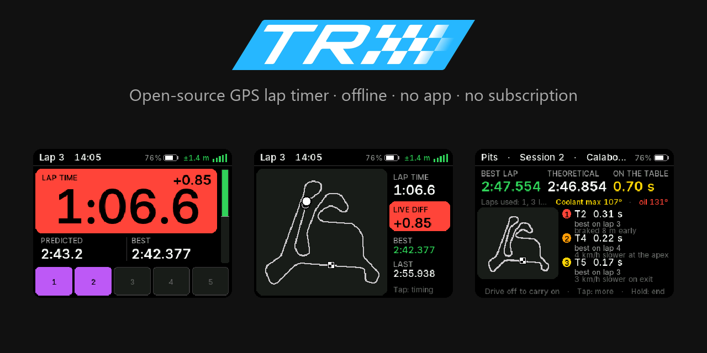

These screenshots are the real display code, rendered on a PC by `tools/render_screens.py`.

Try the analysis on a sample session at [trackrat.me/analyze](https://trackrat.me/analyze/).

## What it does

- Picks the track itself: 129 built-in tracks, and it learns new ones.
- 20 Hz GPS, with each line crossing timed between fixes.
- Live delta and predicted lap.
- Sessions start and end by themselves, and a pit debrief shows the corners where time went.
- Logs every fix in VBO, which Circuit Tools and RaceRender open.
- A Wi-Fi page on your phone to download sessions. No app.
- Works with RaceChrono, Harry's LapTimer and TrackAddict (as a RaceBox Mini), and takes engine data from a Bluetooth OBD-II adapter.
- Puts GPS into DJI Osmo Action videos.

## Screenshots

| | | |
|---|---|---|
| 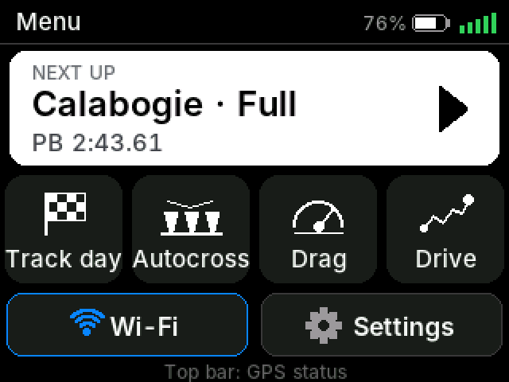 Menu | 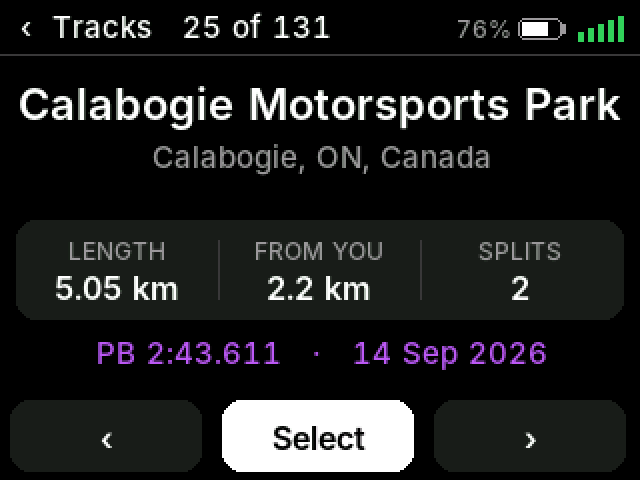 Track list | 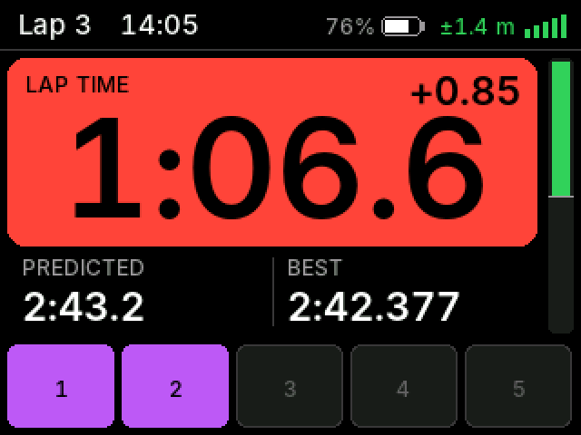 Timing, ahead of the reference lap |
| 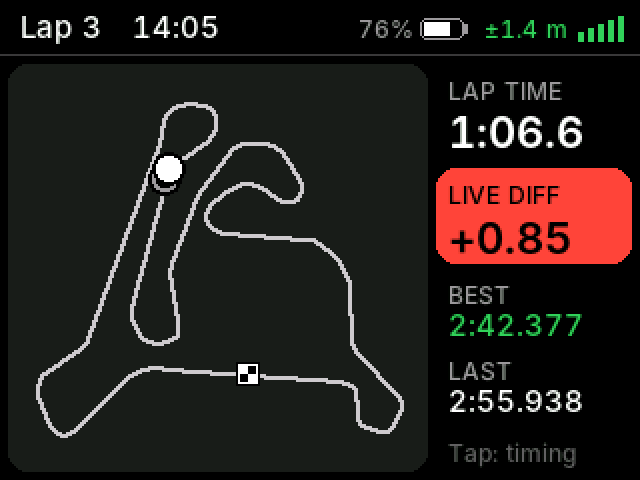 Map view | 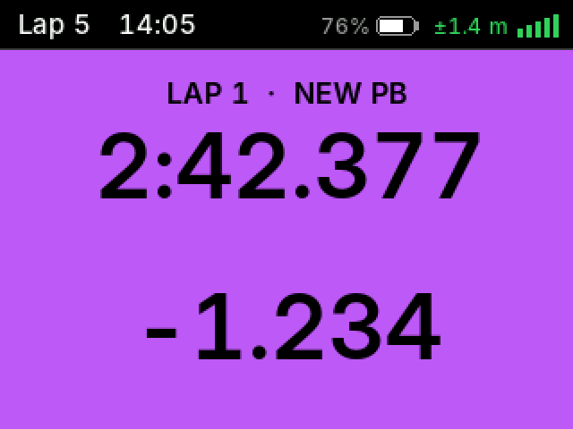 A new personal best | 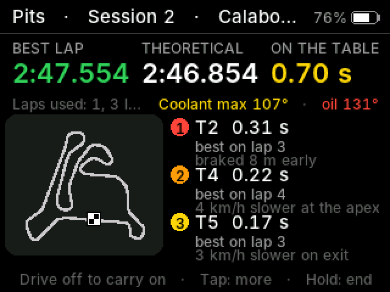 Pit debrief |
| 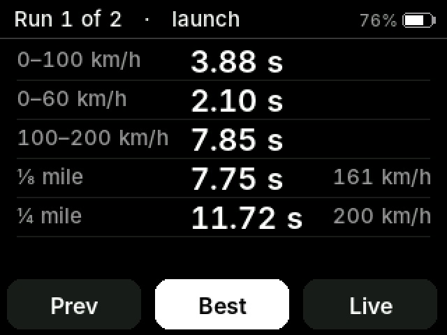 A 0-100 km/h result | 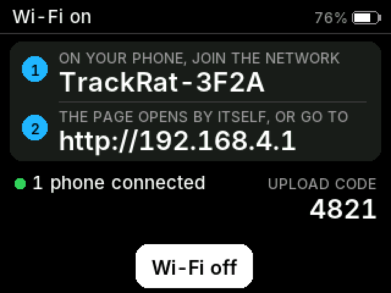 Wi-Fi page | 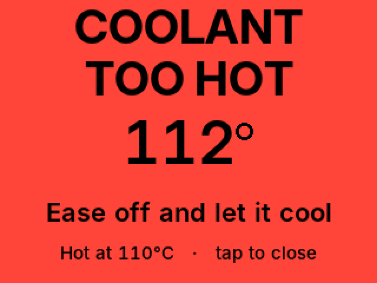 Overheat warning |

[All screens](docs/images/gallery.png)

## Build one

Prices are approximate. AliExpress or Amazon will have all of it.

| Part | Why | Rough price |
|---|---|---|
| ES3C28P board (ESP32-S3, 2.8" touch display, SD slot) | The brain and the screen | US$25-35 |
| Beitian BE-252Q GPS | u-blox M10, 20 fixes a second | US$15-25 |
| microSD card | Sessions and logs (optional but worth having) | varies |
| USB-C cable, or car USB power | Power, and flashing | varies |
| LED bar and big button (optional) | Delta at a glance, start and stop without the touchscreen | varies |
| Bluetooth OBD-II adapter (optional), such as the Veepeak OBDCheck BLE+ | Engine data | about US$30 |
| IMU, CAN transceiver (optional) | Cornering g, wired engine data | varies |

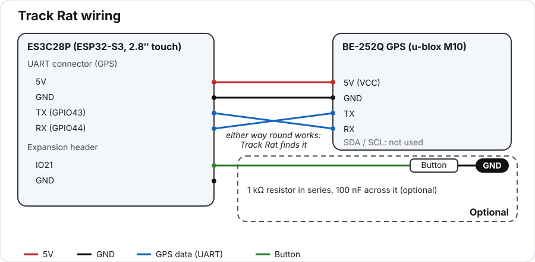

Pins, wiring and the optional add-ons are in [docs/hardware.md](docs/hardware.md).

## Install the firmware

**[Install from your browser](https://trackrat.me/)**. You need Chrome or Edge and a USB-C data cable. It erases what's saved in the board's internal flash; the SD card is untouched.

- Download a release and write it with esptool: [docs/flashing.md](docs/flashing.md#download-a-release-and-use-esptool).
- Update from the SD card or the Wi-Fi page, no cable: [docs/flashing.md](docs/flashing.md#update-without-a-cable).
- Build from source with PlatformIO: [docs/flashing.md](docs/flashing.md#build-from-source-with-platformio).

First time? [TESTING.md](TESTING.md) checks each part of the hardware.

## First drive

1. Mount it with a clear view of the sky.
2. Switch on and wait for the GPS lock (the bars in the top bar).
3. At a known track, it's picked for you. Otherwise choose from the track list, or make a New Track.
4. Drive. Timing starts at the line.
5. Park in the pits for a minute for the debrief. Download the session on the Wi-Fi page.

More in the [user guide](docs/user-guide.md).

## How accurate is it?

Lap times come from the GPS's own clock (u-blox M10 at 20 Hz, GPS and Galileo), with each line crossing timed between fixes, not rounded to 50 ms. With open sky at circuit speeds, a lap is good to roughly ±0.01-0.03 s, so read the debrief's third decimal as hundredths. It's worse at slow lines (karting hairpins, pit exits) and under trees or stands. Laps with poor GPS are tagged suspect.

## Status: beta

Version 0.1 is a beta. What's been tried on real hardware:

| Tried on hardware? | What |
|---|---|
| Yes | Installing from the browser; lap timing and logging on the ES3C28P with the BE-252Q; the Wi-Fi page; a Bluetooth OBD-II adapter (Veepeak OBDCheck BLE+); coolant on screen |
| Not yet | The DJI Osmo Action remote, the RaceChrono DIY profile, the IMU, CAN |
| Not yet confirmed | RaceBox Mini mode with phone apps, the LED bar and big button, the battery |

See the [changelog](CHANGELOG.md).

## More

- [User guide](docs/user-guide.md): driving, settings, tracks, the Wi-Fi page, session logs.
- [Hardware](docs/hardware.md): wiring, GPS data, add-ons.
- [Phone apps and video](docs/phone-and-video.md): RaceChrono, RaceBox Mini mode, DJI Osmo Action, overlay videos.
- [Flashing](docs/flashing.md)
- [Development](docs/development.md): configuration, tests, code layout.
- [Roadmap](ROADMAP.md), [changelog](CHANGELOG.md), [contributing](CONTRIBUTING.md)

## Licence and credits

- Track Rat is MIT licensed: see [LICENSE](LICENSE).
- Third-party licences: [THIRD_PARTY_LICENSES.md](THIRD_PARTY_LICENSES.md).
- Track data © OpenStreetMap contributors (ODbL): see [DATA_LICENSE.md](DATA_LICENSE.md).
- The Inter font is under the SIL Open Font Licence.
